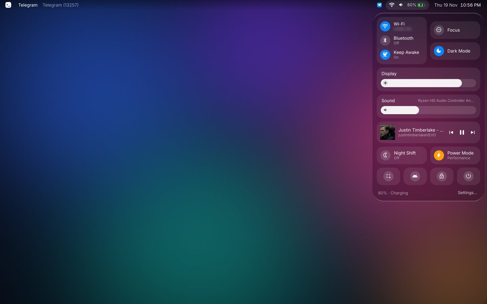
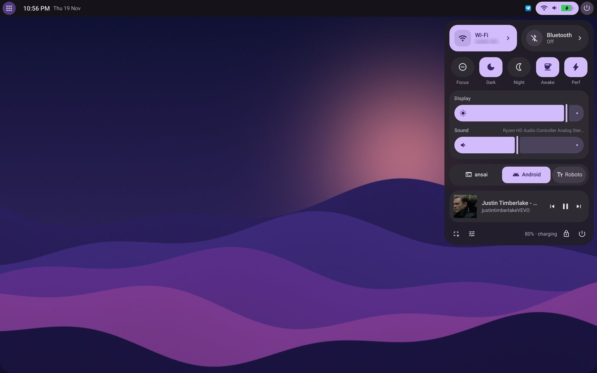
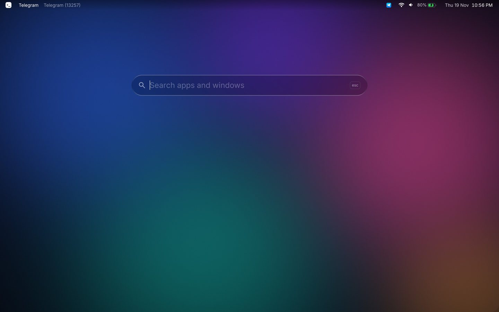
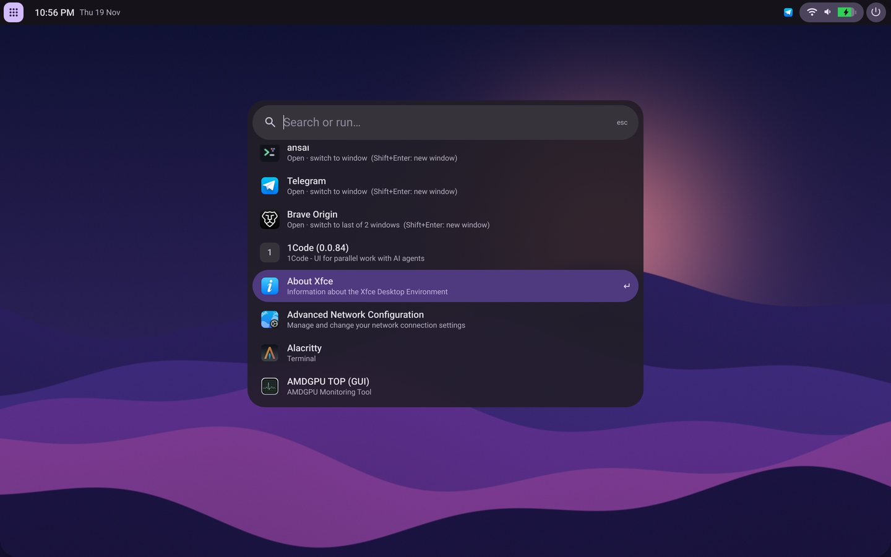
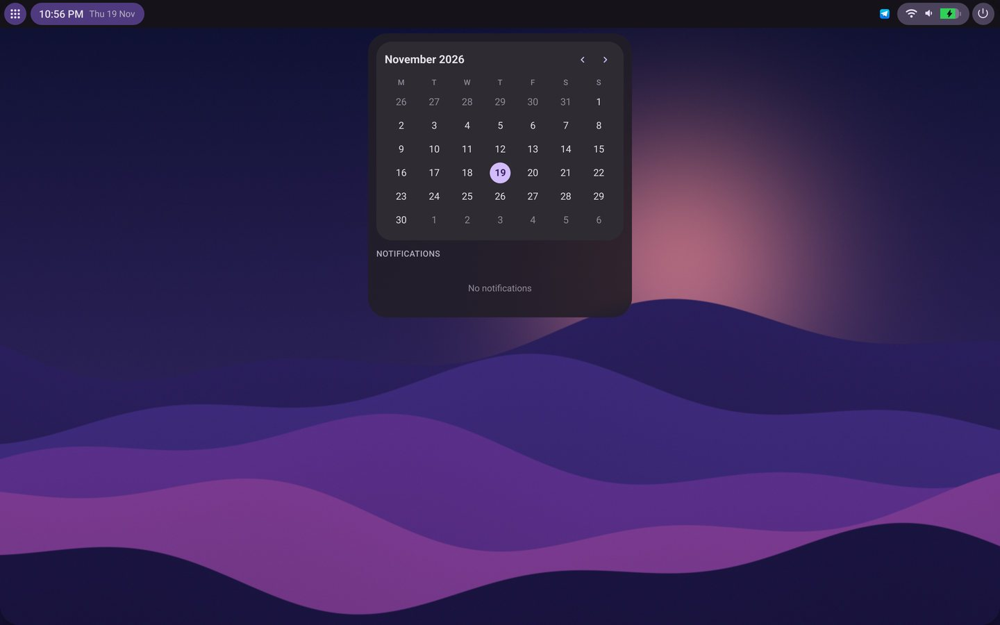
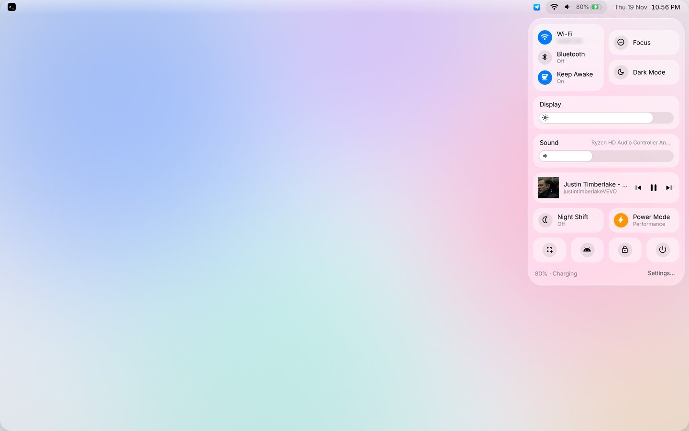

# ansai-shell

**[Website](https://ansai-shell.public.koompi.cloud)** · [Showcase video](docs/showcase.mp4) · [Install](#install) · [Keys](#keys)

A Wayland desktop for [niri](https://github.com/YaLTeR/niri), written in [Quickshell](https://quickshell.org) (QML).
It comes in two looks you can switch between at any time:

- **ansai**: macOS-style Liquid Glass. Transparent menu bar, glass panels with a lit rim, a Control Center made of
  modules, a floating search bar, menu-bar volume/brightness, a left dock.
- **Android**: Material 3 Expressive. Colours taken from your wallpaper, big rounded shapes, Roboto.

Both come in light and dark, and the built-in wallpapers switch with them.

| ansai (Liquid Glass) | Android (Material 3) |
| --- | --- |
|  |  |
|  |  |
|  |  |
|  |  |
|  |  |
|  |  |

A 40-second recording of both looks, light and dark, and wallpaper changes: [`docs/showcase.mp4`](docs/showcase.mp4).
The website is `docs/index.html` (one file, no build step), live at **https://ansai-shell.public.koompi.cloud**
(KOOMPI Cloud service `ansai-shell`, nginx via `docs/Dockerfile`). To update it, zip `docs/` and deploy it to that
service with the KOOMPI Cloud connector, or run `KCONSOLE_API_TOKEN=kp_... tools/deploy-site.sh`.

## What's in it

- **Top bar:** the focused app, the current workspace's windows left to right (click, scroll, drag to reorder),
  tray, status and clock. In ansai, the `>_` mark opens the system menu.
- **Dock** on the left: Launchpad button, workspaces (niri stacks them vertically), pinned and running apps;
  auto-hides when a window would cover it. Right-click for windows, actions, pin, quit.
- **Control Center:** Wi-Fi and Bluetooth with lists to connect, Focus, dark mode, night light, power mode,
  brightness, volume, now playing.
- **Search** (Super+Space or Alt+Space): apps and windows; an app that is already open is switched to
  (Shift+Enter starts a new one). `>cmd` runs in the terminal, `=1+2` calculates.
- **Launchpad** (the ⋮⋮⋮ button at the top of the dock): every app as a paged icon grid over the blurred desktop,
  sorted into tabs (Frequent: what you open, pin or have running; All; then Internet, Develop, Media, Office, System…;
  Tab/Shift+Tab switches) and a search field that covers every app. Swipe with two fingers, drag, scroll or ←/→ to
  flip pages, Enter opens the first match, Esc or a click on empty space closes.
- **Quick Note** (Alt+N): a notes panel that opens on your latest note and saves as you type
  (`~/.local/share/ansai-shell/notes.json`). Notes are Markdown, shown formatted (headings, bold, lists, links, code):
  click a line to edit there, click ☐ to tick a to-do, just type to add a line. Ctrl+N new note, Esc stops editing, then closes.
  Ask Ansai about the open note from the field at its bottom (summarize, fix, translate, add a to-do) and add the answer
  to the note or replace it. Ask Ansai can also write notes itself ("add to my quick note: …").
- **Clipboard history** (Super+Shift+C): text and images with thumbnails, search, Enter to copy, Delete to remove.
- **Quick Ask:** point at the middle of the bottom edge and an Ask Ansai field slides up; Enter asks and the answer
  streams right above it ("Open in Ask Ansai" continues in the sidebar). Always shown on an empty workspace; with
  windows open it hides when the pointer leaves, unless you're typing.
- **App hotkeys:** one key per app that switches to it, starts it, or (pressed again) goes back to where you were.
  See [Keys](#keys).
- **Ask Ansai** on the [KOOMPI AI Gateway](#ai) (Super+I): an agent that works on your computer (files, commands,
  apps, windows, notes) and on KOOMPI Cloud, and can **use other apps for you**: it reads their screens through
  accessibility or looks at them, then clicks and types. It asks before it changes anything, and **learns from
  its mistakes** so the next run takes fewer steps. Also: ask about part of the screen (Super+Shift+S), and translate /
  summarize / fix / find-by-description in the clipboard panel. See [AI](#ai).
- **Notifications, calendar, OSD, lock screen, polkit prompts, power menu.**
- **Settings app:** appearance, wallpaper, dock, displays (resolution, refresh, scale, rotation, VRR, with a
  15 s "keep changes?"), graphics (supergfxctl: integrated / hybrid / dGPU), power and battery (profile, charge
  limit, keyboard light), sound, about.
- **System theme:** GTK 3/4, libadwaita, Qt and Ghostty follow the shell's colours and font.
- **Wallpapers:** Drift, Ribbons and Dunes, drawn by `tools/wallpapers.py`, each in light and dark.
  Any `name-light` / `name-dark` pair (and GNOME's `-l` / `-d`) follows the theme.

## Install

```sh
sudo pacman -S --needed niri xwayland-satellite quickshell brightnessctl playerctl swayidle cliphist fuzzel wlsunset grim slurp python nodejs fd ripgrep wtype python-gobject at-spi2-core
./install.sh
```

Log out, choose **Niri** in the login screen's session menu. Your old desktop stays available there.

## Keys

| Key | Action |
| --- | --- |
| Super+Space / Alt+Space | Search apps/windows (`>cmd` runs in terminal, `=1+2` calculates) |
| Super+A | Control center |
| Super+N | Calendar + notifications |
| Super+Esc | Power menu |
| Super+L | Lock |
| Super+Return | Terminal |
| Super+E / Super+B | Files / browser |
| Super+Shift+C (or Super+Shift+V, Alt+Shift+C) | Clipboard history: type to filter, Enter copies, Delete removes |
| Alt+N | Quick Note |
| Super+I / Alt+A | Ask Ansai sidebar |
| Bottom edge (hover) | Quick Ask field |
| Dock ⋮⋮⋮ | Launchpad (two-finger swipe / ←→ pages, Tab switches category) |
| Super+Shift+S / Alt+Shift+S | Pick part of the screen and ask Ansai about it |
| Clipboard: Ctrl+T / Ctrl+S / Ctrl+E / Ctrl+J / Tab | Translate / summarize / fix writing / ask in sidebar / AI find |
| Super+O | Overview |
| Super+Backspace | Close window (Caps Lock works as Super) |
| Print / Super+Shift+A / Alt+Shift+A | Screenshot an area |
| Super+Shift+←/→ | Move the current window left/right |
| Super+Shift+/ | All shortcuts |

**App hotkeys.** Put your own in `~/.config/niri/ansai-keys.kdl` (included by the config, not part of the repo).
`shell app <desktop-id>` switches to the app, starts it if it isn't open, and if it's already in front goes back
to the window you were on:

```kdl
binds {
    Alt+Shift+T { spawn "qs" "-c" "ansai" "ipc" "call" "shell" "app" "org.telegram.desktop"; }
    Alt+B       { spawn "qs" "-c" "ansai" "ipc" "call" "shell" "app" "brave-origin"; }
}
```

The desktop id is the `.desktop` file name without the extension (`ls ~/.local/share/applications /usr/share/applications`).


## Settings

The Settings app (control center gear, "ansai Settings" in the launcher, or `qs -c ansai ipc call shell settings <page>`) covers
appearance, wallpaper, dock, displays, graphics (supergfxctl), power, fan speed curves and battery (asusctl, power-profiles-daemon), sound, AI and about.
Display changes apply live and revert after 15 s unless kept; kept ones go to `~/.config/niri/ansai-outputs.kdl`.
GPU mode switches only ask supergfxd; you log out or reboot yourself.

Everything else is saved in `~/.config/ansai-shell/settings.json` (theme, wallpaper, terminal, use24h, …); hand edits apply live.

```sh
qs -c ansai ipc call shell theme light
qs -c ansai ipc call shell wallpaper ~/Pictures/wall.jpg
```

## AI

Uses the [KOOMPI AI Gateway](https://ai.koompi.cloud) (OpenAI-compatible). Paste your `kpi_…` key in
**Settings → AI**; it is saved to `~/.config/ansai-shell/ai-key` (mode 600) and only the agent reads it.
The default model is `koompi-luna` (Mekong: Khmer and images); pick another there or set `"aiModel"` in settings.json.

- **Ask Ansai** (Super+I or Alt+A, or ✦ in Control Center): an agent built on [pi-mono](https://github.com/badlogic/pi-mono)
  (`pi-agent-core` loop, `pi-ai` streaming), in English or Khmer. It can run commands, read, write, edit and search files,
  open files, URLs and apps, list, focus and arrange windows, read or copy the clipboard, look at the screen and read web pages
  ("free up space in Downloads", "move Telegram to workspace 2", "what's using my CPU?"). Looking things up runs
  right away; commands, file changes and other actions show what they will do with **Allow / Always allow / Deny**.
  Attach a screen area, or paste
  (Ctrl+V or the clipboard button) text or an image such as a screenshot you just took. The conversation stays until you start a new one.
  Every chat is saved (Chats list, `~/.local/share/ansai-shell/ai-chats.json`, private to you) and survives restarts.
  The ⤢ button switches between the right-side panel and a big centred view with the chat list beside it.
- **Ask about the screen** (Super+Shift+S or Alt+Shift+S): pick an area; it is saved to `~/Pictures/Screenshots`, copied, and
  opened in the sidebar with the image attached ("what does this error mean?").
- **Clipboard panel:** Ctrl+T translates English ↔ Khmer (language in Settings), Ctrl+S summarizes, Ctrl+E fixes
  spelling and grammar; Enter copies the result. Type a description and press Tab to have AI find it
  ("the wifi password", "that ssh command"). Ctrl+J sends the entry (or image) to the sidebar.

- **Using other apps:** Ask Ansai lists open apps, reads their window as text through AT-SPI accessibility
  (`quickshell/scripts/desktop.py`, from ansai), or takes a screenshot,
  then clicks buttons, fills fields and types ("search YouTube for lofi in Brave", "reply 'ok' in Telegram").
  Panels step out of the way while it works and the answer shows again after. Typing uses wtype, or xdotool for X11 apps.
  Chromium browsers (Brave, Chrome) only show their pages when started with `ACCESSIBILITY_ENABLED=1` in the
  environment and `--force-renderer-accessibility` (e.g. `Exec=env ACCESSIBILITY_ENABLED=1 …` in a copy of the app's
  .desktop file in `~/.local/share/applications`, and the flag in `~/.config/<browser>-flags.conf`);
  otherwise it falls back to screenshots and the mouse.
- **Learning:** after a task that took many steps or hit a failure, a short review saves one lesson
  ("YouTube: open the search-results URL instead of typing") to `~/.local/share/ansai-shell/ai-lessons.md`; the agent
  can also save one itself when it finds a better way. Lessons are added to its instructions next time.
  **Settings → AI → Learning** turns it off and lists the lessons so you can delete any.
- **Quick Note:** "add to my quick note: call the bank", "what's in my notes?", "turn my last note into a checklist".
  Inside Quick Note (Alt+N) the ✦ field asks about the open note; **Add to note** / **Replace note** applies the answer.
- **Quick Ask** (bottom edge): the same agent in a small field; a quick question starts its own chat, follow-ups continue it.
- **Connectors (MCP):** in Settings → AI, **Connect** KOOMPI Cloud (`mcp.koompi.cloud`, listed by default) or add
  any MCP server URL. Sign-in opens in your browser (OAuth with PKCE); tokens stay in
  `~/.config/ansai-shell/mcp-tokens.json` (mode 600). Ask Ansai can then use the server's tools ("what's running on my
  KOOMPI Cloud?"). Read-only tools run directly; anything that may change something shows **Allow / Always allow / Deny** first.
- **Always allow** (or turning off "Ask before actions" in Settings → AI) lets every action run without asking, including
  commands and file changes on this computer.
- The agent is `quickshell/agent/ansai-agent.mjs`, bundled into `ansai-agent.js` so nothing needs installing besides
  Node. After changing it: `cd quickshell/agent && npm install && npm run build` (needs bun).

```sh
qs -c ansai ipc call ai toggle
qs -c ansai ipc call ai send "ស្វាគមន៍! what can you do?"
qs -c ansai ipc call ai image ~/Pictures/diagram.png
qs -c ansai ipc call ai bar          # open the Quick Ask field
qs -c ansai ipc call shell toggle note
```

## System theme

The shell themes apps to match (`quickshell/services/SystemTheme.qml`), live on every style/theme/wallpaper change:
GTK4/libadwaita and GTK3 (`~/.config/gtk-{3,4}.0/gtk.css`, adw-gtk3), dark/light, accent and UI font via gsettings
(browsers and Qt follow), and Ghostty (`theme = light:ansai-light,dark:ansai-dark`).
Already-open GTK apps pick up new colours when reopened. The first run backs up what it replaced to
`~/.config/ansai-shell/system-theme-backup/`; to undo, set `"systemTheme": false` in settings.json and run `restore.sh` there.

## Notes

- Closing the lid sleeps the laptop (systemd-logind). For travel, `tools/setup-hibernate.sh` (run it yourself, it
  uses sudo) adds a disk swapfile and makes the lid sleep first, then hibernate after 30 minutes, so a closed laptop
  in a bag ends up fully off. Reboot once afterwards and try `systemctl hibernate`.
- Screen recording: OBS Studio works on niri through the GNOME portal (`sudo pacman -S obs-studio`, add a
  "Screen Capture (PipeWire)" source and pick the screen in the dialog).

- Hybrid laptops: niri renders on the integrated GPU (`debug { render-drm-device }` in `niri/config.kdl`); change
  the device if yours differs (`ls -l /dev/dri/by-path`).
- The ansai glass draws its own blurred wallpaper (`components/GlassBackdrop.qml`) so corners stay smooth;
  the rim light is `quickshell/shaders/glassrim.frag` (rebuild with `qsb --qt6 -o glassrim.frag.qsb glassrim.frag`).
