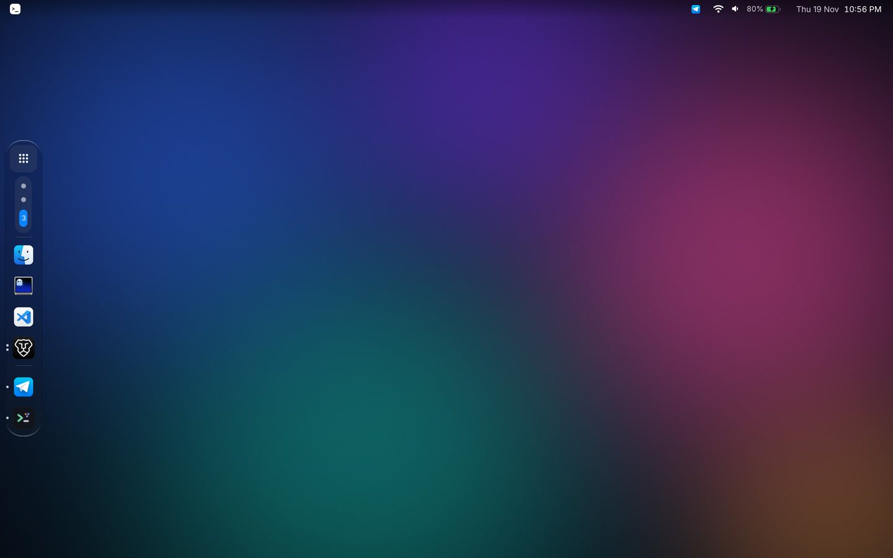
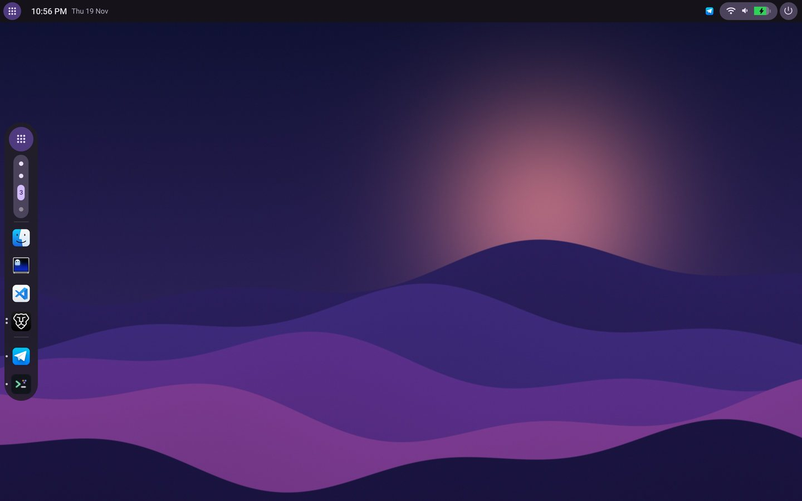
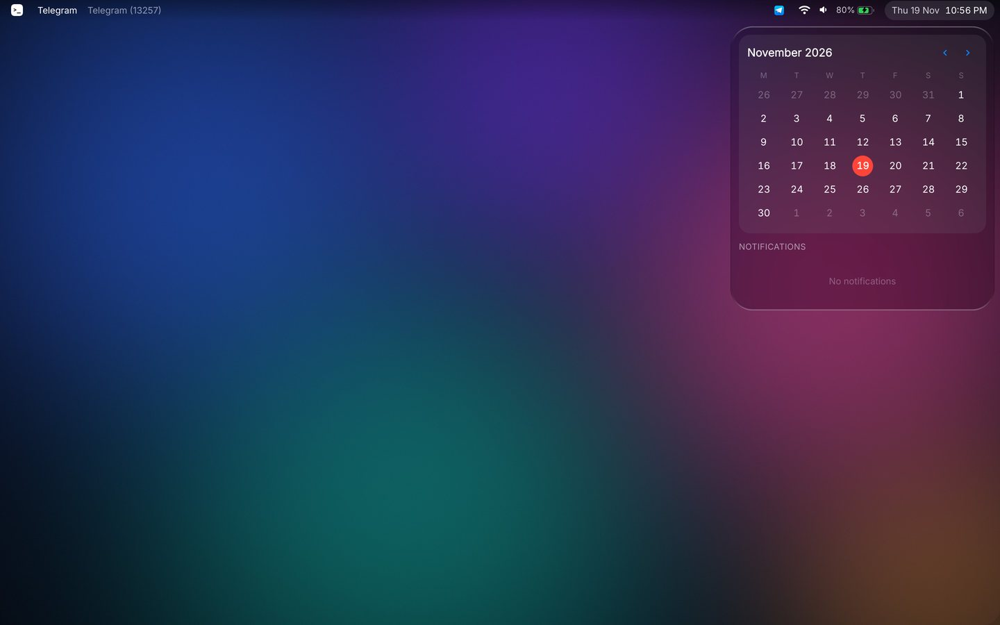
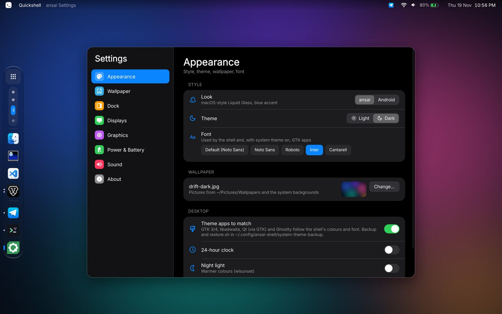
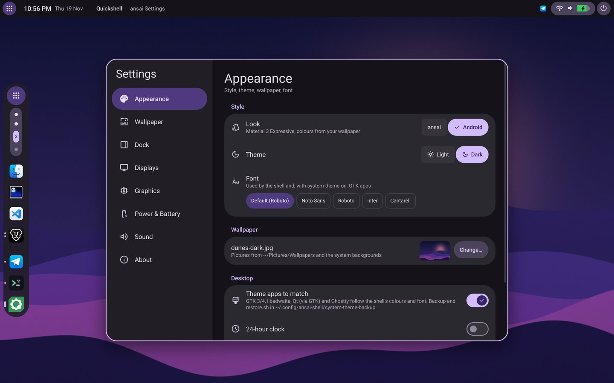
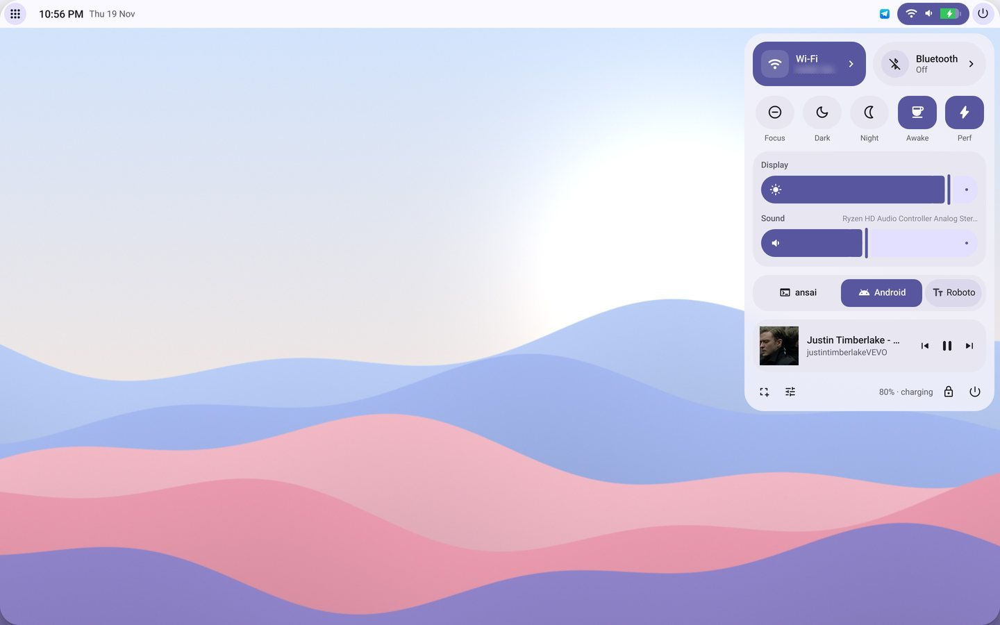

# ansai-shell

A Wayland desktop for [niri](https://github.com/YaLTeR/niri), written in [Quickshell](https://quickshell.org) (QML).
It comes in two looks you can switch between at any time:

- **ansai**: macOS-style Liquid Glass. Transparent menu bar, glass panels with a lit rim, a Control Center made of
  modules, a floating search bar, menu-bar volume/brightness, a left dock.
- **Android**: Material 3 Expressive. Colours taken from your wallpaper, big rounded shapes, Roboto.

Both come in light and dark, and the built-in wallpapers switch with them.

| ansai (Liquid Glass) | Android (Material 3) |
| --- | --- |
|  |  |
|  |  |
|  |  |
|  |  |
|  |  |
|  |  |

A 40-second recording of both looks, light and dark, and wallpaper changes: [`docs/showcase.mp4`](docs/showcase.mp4).
The website is `docs/index.html` (one file, no build step), also published at https://claude.ai/artifact/1TKtpypC1FSLAFBQLoGZdm.

## What's in it

- **Top bar:** the focused app, the current workspace's windows left to right (click, scroll, drag to reorder),
  tray, status and clock. In ansai, the `>_` mark opens the system menu.
- **Dock** on the left: apps button, workspaces (niri stacks them vertically), pinned and running apps;
  auto-hides when a window would cover it. Right-click for windows, actions, pin, quit.
- **Control Center:** Wi-Fi and Bluetooth with lists to connect, Focus, dark mode, night light, power mode,
  brightness, volume, now playing.
- **Search** (Super+Space or Alt+Space): apps and windows; an app that is already open is switched to
  (Shift+Enter starts a new one). `>cmd` runs in the terminal, `=1+2` calculates.
- **Notifications, calendar, OSD, lock screen, polkit prompts, power menu.**
- **Settings app:** appearance, wallpaper, dock, displays (resolution, refresh, scale, rotation, VRR, with a
  15 s "keep changes?"), graphics (supergfxctl: integrated / hybrid / dGPU), power and battery (profile, charge
  limit, keyboard light), sound, about.
- **System theme:** GTK 3/4, libadwaita, Qt and Ghostty follow the shell's colours and font.
- **Wallpapers:** Drift, Ribbons and Dunes, drawn by `tools/wallpapers.py`, each in light and dark.
  Any `name-light` / `name-dark` pair (and GNOME's `-l` / `-d`) follows the theme.

## Install

```sh
sudo pacman -S --needed niri xwayland-satellite quickshell brightnessctl playerctl swayidle cliphist fuzzel wlsunset
./install.sh
```

Log out, choose **Niri** in the login screen's session menu. Your old desktop stays available there.

## Keys

| Key | Action |
| --- | --- |
| Super+Space / Alt+Space | Search apps/windows (`>cmd` runs in terminal, `=1+2` calculates) |
| Super+A | Control center |
| Super+N | Calendar + notifications |
| Super+Esc | Power menu |
| Super+L | Lock |
| Super+Return | Terminal |
| Super+E / Super+B | Files / browser |
| Super+Shift+V | Clipboard history |
| Super+O | Overview |
| Super+Backspace | Close window (Caps Lock works as Super) |
| Print / Super+Shift+S / Alt+Shift+C | Screenshot an area |
| Super+Shift+←/→ | Move the current window left/right |
| Super+Shift+/ | All shortcuts |

## Settings

The Settings app (control center gear, "ansai Settings" in the launcher, or `qs -c ansai ipc call shell settings <page>`) covers
appearance, wallpaper, dock, displays, graphics (supergfxctl), power and battery (asusctl, power-profiles-daemon), sound and about.
Display changes apply live and revert after 15 s unless kept; kept ones go to `~/.config/niri/ansai-outputs.kdl`.
GPU mode switches only ask supergfxd; you log out or reboot yourself.

Everything else is saved in `~/.config/ansai-shell/settings.json` (theme, wallpaper, terminal, use24h, …); hand edits apply live.

```sh
qs -c ansai ipc call shell theme light
qs -c ansai ipc call shell wallpaper ~/Pictures/wall.jpg
```

## System theme

The shell themes apps to match (`quickshell/services/SystemTheme.qml`), live on every style/theme/wallpaper change:
GTK4/libadwaita and GTK3 (`~/.config/gtk-{3,4}.0/gtk.css`, adw-gtk3), dark/light, accent and UI font via gsettings
(browsers and Qt follow), and Ghostty (`theme = light:ansai-light,dark:ansai-dark`).
Already-open GTK apps pick up new colours when reopened. The first run backs up what it replaced to
`~/.config/ansai-shell/system-theme-backup/`; to undo, set `"systemTheme": false` in settings.json and run `restore.sh` there.

## Notes

- Hybrid laptops: niri renders on the integrated GPU (`debug { render-drm-device }` in `niri/config.kdl`); change
  the device if yours differs (`ls -l /dev/dri/by-path`).
- The ansai glass draws its own blurred wallpaper (`components/GlassBackdrop.qml`) so corners stay smooth;
  the rim light is `quickshell/shaders/glassrim.frag` (rebuild with `qsb --qt6 -o glassrim.frag.qsb glassrim.frag`).
